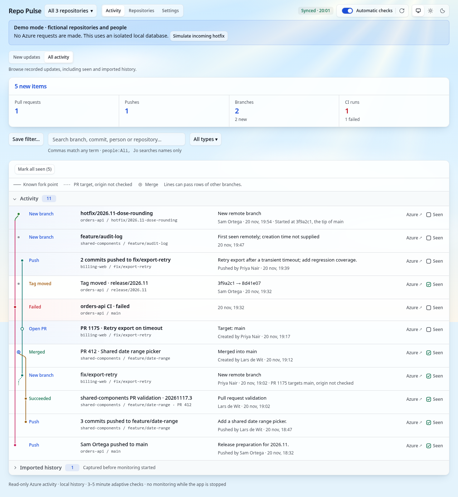

# Repo Pulse


A local Azure DevOps activity feed for testers. Watch multiple repositories for branch changes, pushes, pull requests, and pipeline runs in one place.

<picture>
  <source media="(prefers-color-scheme: dark)" srcset="docs/screenshots/activity-dark.png">
  
</picture>

[Light mode](docs/screenshots/activity-light.png) · [Dark mode](docs/screenshots/activity-dark.png)

## Run locally

Requires **Node.js 26+**, Git, Azure CLI, and the `azure-devops` extension. Repo Pulse uses your existing Azure CLI sign-in. See [Set up the Azure CLI](#set-up-the-azure-cli) if you have not used it before.

```sh
npm ci
npm start
```

`npm start` opens Repo Pulse in your default browser when there is a desktop session. The link it opens, also printed in the terminal, works once and gives the browser this run's access key, which the API requires; every start makes a new one. Set `REPO_PULSE_NO_BROWSER=1` to only print the link. In **Repositories**, choose **Add repositories** and select your local checkouts. Watching a repository includes all its remote branches.

To try it without Azure, run `npm run demo` instead. Demo data is fictional and stored separately.

## Set up the Azure CLI

1. Install the [Azure CLI](https://learn.microsoft.com/cli/azure/install-azure-cli).
2. Add the Azure DevOps extension: `az extension add --name azure-devops`
3. Sign in with the account that can read your repositories: `az login`
4. Optional: run `npm run doctor` to verify Node.js, Git, Azure CLI, the `azure-devops` extension, and a cached Azure CLI account before starting.

Then start Repo Pulse and use **Settings → Check connection**. Your checkouts need an Azure DevOps remote (`dev.azure.com` over HTTPS or SSH). **Check for updates** and **Pull** use your normal Git credentials, such as your SSH key.

## Use Repo Pulse

- **Activity.** Open **New updates** to catch up or **All activity** to browse cached history. Enter `Ali, Jose` in **Search activity** to match either term, including names such as Alice and José. Use `people:Ali Mor, Jose` to search recorded names with partial words in order. Opening an item never marks it seen. On wider screens, **All activity** draws a branch tree in the status column: one lane per branch, a solid fork when the commit the branch started at was the tip of, or already on, one other branch, a dotted fork to its pull request target when the origin was not checked, and a curve where a completed pull request merges. A pull request validation run shows the branch of its pull request and joins that branch's lane.
- **Catch up.** The Activity summary counts every unread update in scope, on every page. Tick **Seen** on a row (tick it again to mark the row unread). **Mark all seen (N)**, or **Mark all matching seen (N)** with filters applied, clears every unread update the page was read with, across all pages; updates recorded after the page loaded stay unread. In **New updates**, **Mark shown seen** clears only the loaded rows in open groups. **Undo** restores the updates changed by your action.
- **Saved filters.** Choose **Save filter…** to save your search, activity type, repository scope, and Activity tab. Choosing a saved filter applies it immediately. Edits show **Modified** and stay in your current view until you choose **Update**. Use **More** to save a variation, restore the saved version, or manage the filter.
- **Switch branches.** In **Repositories**, choose **Switch branch…** beside the current branch and pick one of the repository's watched branches. On an Activity detail that names one branch, choose **Switch to …**: a new branch, a push, a build, the source of an active pull request from the same repository, or a completed pull request's target (such as `main`). Repo Pulse verifies the remote and refreshes the local tracking ref before switching. It asks for confirmation if the upstream history was rewritten or the local branch has diverged. Git carries compatible local edits and stops if switching would overwrite them. After the switch, **Repositories** shows the checkout and its update controls.
- **Repositories.** See your checked-out branch, sync older activity, or use **Check for updates**. **Pull** asks for confirmation and fast-forwards when Git can preserve your local changes.
- **Sync status.** The header shows whether activity is **Synced**, **Syncing**, **Delayed**, **Paused**, or has a **Problem**, and each enabled repository shows its own sync status in **Repositories**. A disabled repository shows **Disabled** and has no sync status.
- **Settings.** Check Azure DevOps access, manage automatic checks, copy diagnostics from **Troubleshooting**, or **Start from scratch** to delete stored activity and import the last seven days again.

Watches, saved filters, activity, and seen state stay in `.repo-pulse/live.sqlite`. Monitoring runs while the app is open. Azure activity access is read-only. Confirmed checkout actions can change files and refs in your local Git repository.

See [coverage and limits](docs/COVERAGE.md), the [roadmap](PLAN.md), and the [maintainer notes](docs/MAINTAINING.md).
